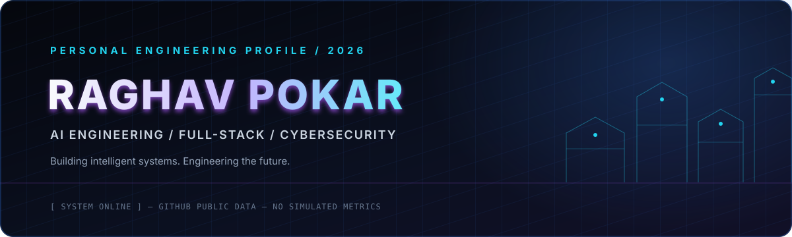
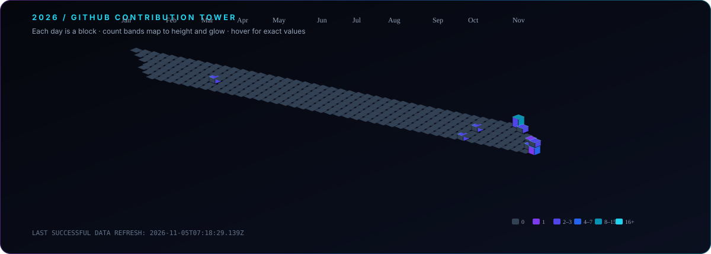
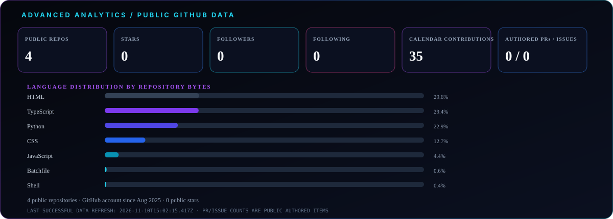
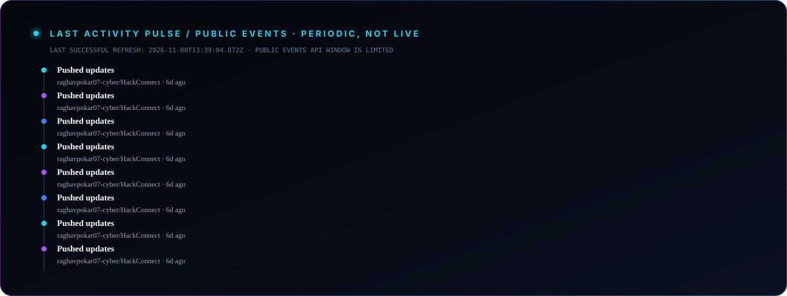
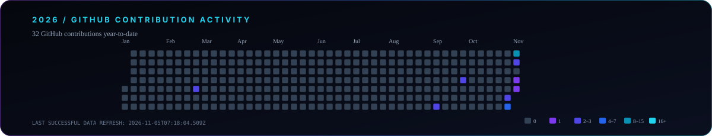
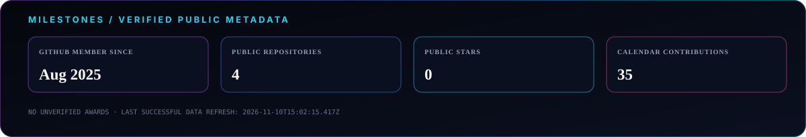

## 01 / CINEMATIC HERO

 

### BUILDING INTELLIGENT SYSTEMS. ENGINEERING THE FUTURE.

AI ENGINEERING &nbsp;·&nbsp; FULL-STACK DEVELOPMENT &nbsp;·&nbsp; CYBERSECURITY

[GitHub profile](https://github.com/raghavpokar07-cyber) &nbsp;·&nbsp; [Repositories](https://github.com/raghavpokar07-cyber?tab=repositories)

---

## 02 / DEVELOPER IDENTITY

I build practical software across AI, web engineering, and security. My public work spans TypeScript, Python, and web technologies, from collaborative products to smaller experiments.

## 03 / TECH STACK HOLOGRAM

**Verified in public repositories:** TypeScript · Python · JavaScript · HTML · CSS · React · Vite · Node.js · Express · MongoDB · Gemini

**Focus areas:** AI engineering · Full-stack systems · Cybersecurity

## 04 / 3D CONTRIBUTION TOWER

Each isometric block represents a real day from GitHub's contribution calendar. Tower height and color encode the day's actual count; hover/tap a block to inspect its date and exact count. GitHub may include aggregate private-activity counts according to the profile's visibility settings; private repository details are never queried for display.

## 05 / ADVANCED ANALYTICS GRID

## 06 / FEATURED PROJECT SHOWCASE

<!-- PROJECTS:START -->
| Project | Verified summary | Primary language | Relationship |
|---|---|---|---|
| [HackConnect](https://github.com/raghavpokar07-cyber/HackConnect) | HackConnect is an AI-powered platform that helps students discover hackathons, find teammates based on their skills, form teams, chat, assign roles, and collaborate on projects. It brings hackathon opportunities and student communities toge | TypeScript · React · Express · MongoDB | Creator · [Demo](https://hack-connect-indol.vercel.app/) |
| [AI Teacher](https://github.com/raghavpokar07-cyber/ai-tTeacher) | AI Teacher project with Python, HTML, and separate backend and frontend folders. | Python · HTML · CSS · JavaScript | Personal project |
| [NPC](https://github.com/raghavpokar07-cyber/NPC) | HTML experiments including a 3D page and digital visiting-card pages. | HTML | Personal web experiments |
| [JobGuardAI_MUSA](https://github.com/kkolap22/JobGuardAI_MUSA) | JobGuard AI is a full-stack application designed to protect job seekers from deceptive and malicious recruitment websites. It combines browser automation, risk detection rules, and AI-powered analysis to scan suspicious job portals and flag | TypeScript · React · Express · MongoDB · Playwright | Contributor \(2 public contributions listed\) · [Demo](https://job-guardai-musa.vercel.app/) |
<!-- PROJECTS:END -->

## 07 / LAST ACTIVITY PULSE

Public GitHub events are sampled periodically; this is **not real-time**. The generated feed displays its actual refresh time and only shows activity returned by GitHub's public Events API.

## 08 / GITHUB CONTRIBUTION ACTIVITY

The tower and analytics are generated from GitHub's contribution calendar for the current year. GitHub Actions refreshes the assets daily; the timestamp in each graphic is the last successful data refresh.

## 09 / ACHIEVEMENTS & MILESTONES

Milestones and counts are sourced from public GitHub metadata. No unverified awards, project status, or activity totals are included.

## 10 / CONNECT WITH ME

Find me on [GitHub](https://github.com/raghavpokar07-cyber).

---

## 11 / FUTURISTIC TERMINAL FOOTER

`PROFILE SYSTEM / DATA SOURCE: GITHUB PUBLIC API / REFRESH: SEE GENERATED PANELS`

